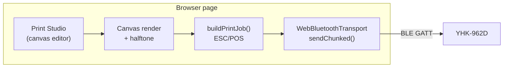

# Architecture

## Overview

This project prints to YHK-series mini thermal printers (tested against YHK-962D) from a browser page over Web Bluetooth. There is no backend: composing, dithering and ESC/POS encoding all happen in the tab, which then writes the bytes straight to the printer's GATT characteristic.



## Page

`index.html` with `src/main.ts` is the whole app: the Print Studio, a free-form canvas of text, image, sticker, QR and rule elements. It uses the connection UI (`src/ui/connection.ts`), the transport, and the `shared/` encoding modules.

Pictures and PDFs come in through `src/studio/source.ts` and `src/studio/pdf.ts`. pdf.js is imported dynamically, so its roughly 1.7 MB (parser plus worker) is only downloaded when someone opens a PDF. Each PDF page is rendered at four times the head width and becomes an ordinary image element.

## Postage label conversion

`src/studio/postage.ts` turns a carrier's label PDF into a single 384-dot-wide 1-bit image:

1. **Find labels** — render each page at 4 px/mm, mark non-white 1 mm cells, bridge 3 mm gaps and take each large connected cluster as a label.
2. **Decode** — render each label at 16 px/mm and read every barcode with zxing-cpp (WebAssembly, lazy-loaded with its `.wasm` served locally).
3. **Rebuild codes** — matrix codes use the decoder's module grid (`ReadResult.symbol`). Linear codes are sampled on several scan lines, snapped to whole modules by the best-fitting module count, and accepted only when most lines agree. Modules land on whole dots (linear codes at no less than their original X-dimension) and run along the paper.
4. **Lay out the artwork** — with the codes erased, thin long rules are found and removed. The vertical rule nearest the codes splits the address column from the code column. A top band crossing both columns is the header. The address column is cut at its horizontal rules. The code column is XY-cut into small blocks, and blocks next to a code become its captions (rotated with it for horizontal barcodes).
5. **Verify** — the strip is decoded at 2× and every original code must be found with identical format and bytes; otherwise the conversion throws and nothing reaches the page.

The studio places the result as a threshold-mode image at 1:1, and stores print-resolution images as PNG so a reload cannot soften the bars.

## Studio document model

A page is `{ elements[], border, bottomMargin, minHeight }` (`src/studio/types.ts`). Every element carries `x`, `y`, `width`, `height` and `rotation` in printer dots, plus its own type-specific fields. Painting order is array order, so z-ordering is a splice.

Page height is derived, never stored: `documentHeight()` takes the lowest rotated element bound, adds the bottom margin, and clamps to `[minHeight, 4000]`. Moving an element up shortens the paper; dragging one down lengthens it.

Text is the one element whose height is computed rather than set — `layoutText()` wraps to the box width, so `elementHeight()` is what bounds, hit-testing and stacking all use.

## PrinterTransport

Print encoding stays platform-agnostic behind one interface:

```typescript
interface PrinterTransport {
  readonly connected: boolean;
  connect(): Promise<void>;
  disconnect(): Promise<void>;
  send(data: Uint8Array): Promise<void>;
}
```

`WebBluetoothTransport` is the only implementation: it runs the device picker, resolves the ISSC service and TX characteristic, prefers acknowledged writes when the characteristic advertises them, and paces chunks through `sendChunked()`.

Shared modules:

- `escpos.ts` — ESC/POS command encoding (`ESC @`, density, `GS v 0` raster, feed)
- `halftone.ts` — grayscale conversion, tone adjustments, halftone algorithms
- `send-chunked.ts` — chunk pacing with a post-job flush delay

## Render pipeline

`renderPage()` (`src/studio/render.ts`) composes the whole page at 1:1 and hands back both the 1-bit canvas and the `boolean[][]` the encoder wants.

1. **Page** — a white canvas 384 dots wide and `documentHeight()` tall.
2. **Elements** — each one drawn under `translate(centre) → rotate → translate(-half)`:
   - *text* wraps and draws (or knocks out of a black block),
   - *sticker* renders on its own transparent buffer (several punch holes with `destination-out`, which would otherwise erase the page),
   - *QR* draws whole modules so cells survive thresholding,
   - *rule* strokes its style,
   - *image* is dithered at its placed size and cached by a key covering every tone setting.
3. **Border** — the frame is painted last, so ticket notches can punch through content.
4. **Threshold** — one pass over the composite turns antialiased edges into crisp dots. Pre-dithered images are already black and white, so only text and shape edges are affected.
5. **Encode** — `buildPrintJob(pixels, { feedLines, density })` → one `Uint8Array`, sent in paced 180-byte chunks. `density` is the darkness picked on the Print tab.

Image elements themselves go through `src/studio/raster.ts`: crop → flip → stepped downscale → grayscale → auto-level, brightness, contrast, gamma, unsharp mask, invert → halftone.

## Editing

`src/studio/stage.ts` owns the interactive canvas. It renders the page at 2× and draws selection chrome on top, then maps pointer events back into page dots. Hit-testing and resizing both work in the element's unrotated frame (rotate the pointer by `-rotation` about the centre); after a resize the opposite handle is pinned in page space so rotated boxes grow the way you expect. Corner handles keep aspect for images and QR codes, and scale the font for text.

## Why browser-only

Web Bluetooth keeps the whole app static: no server to run, no data leaving the page, and GitHub Pages can host it. The trade-offs are real — Safari and iOS have no Web Bluetooth, the tab must be in BLE range, and one tab holds one connection — but for printing from a laptop or Android phone next to the printer, that is the whole story.
